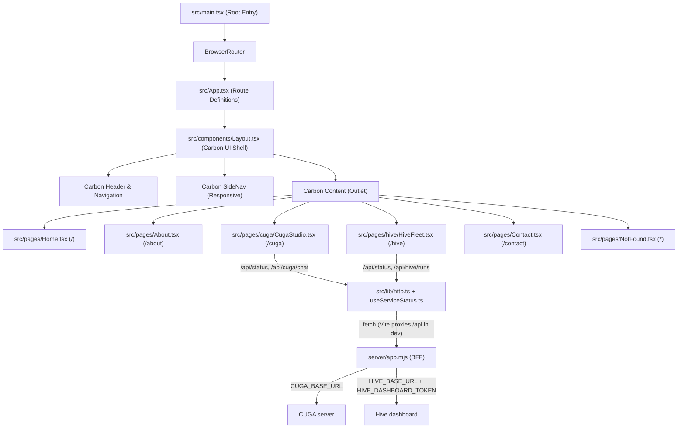

# Architecture

This document describes the architectural design, component hierarchy, styling system, and testing structure of the Beehive static application.

## Overview

Beehive is a client-side web application with a small Node backend-for-frontend (BFF) in `server/`. The static pages work without the BFF; the CUGA Studio and Hive Fleet pages use it for live data and fall back to a guided preview when it is not running. The site is built with:

- **React 19** for UI components and state management
- **Vite** for fast module bundling and development server
- **TypeScript** in strict mode for type safety
- **IBM Carbon Design System** (`@carbon/react`) for accessible, enterprise-grade UI components
- **react-router-dom** for declarative browser-based routing
- **Sass (SCSS)** for styling with Carbon design tokens and IBM Plex typography
- **Node `http` server** (`server/`) as the only server-side component and the only place service credentials live



## Application Structure

```
src/
├── components/          # Shared layout and UI components
│   ├── Layout.tsx       # IBM Carbon UI Shell wrapper with navigation
│   ├── Layout.test.tsx  # Layout unit tests
│   ├── ErrorBoundary.tsx       # Catches render errors inside the layout
│   └── ErrorBoundary.test.tsx
├── data/
│   ├── agents.ts        # Agent roster shared by Home and About
│   └── agents.test.ts
├── lib/
│   ├── http.ts          # /api client: getJson, postJson, describeError, ERROR_MESSAGES
│   ├── useServiceStatus.ts  # Hook that reads /api/status
│   └── api.ts           # Backwards-compatible re-exports; import from the two files above
├── pages/               # Route-level page components
│   ├── Home.tsx         # Hero banner, mission, and agent role tiles
│   ├── Home.test.tsx
│   ├── About.tsx        # Agent roster table and detailed accordion
│   ├── About.test.tsx
│   ├── Contact.tsx      # Contact form with validation and notifications
│   ├── Contact.test.tsx
│   ├── cuga/            # CUGA Studio: CugaStudio.tsx, guidedEngine.ts (offline demo) and tests
│   ├── hive/            # Hive Fleet: HiveFleet.tsx, sampleData.ts (preview data) and tests
│   ├── NotFound.tsx     # Catch-all 404 page
│   └── NotFound.test.tsx
├── test/
│   └── setup.ts         # Vitest setup and jest-dom matchers
├── App.tsx              # Application route tree
├── App.test.tsx         # Routing and layout integration tests
├── index.scss           # Sass configuration, Carbon imports, and layout classes
└── main.tsx             # DOM mounting with React 19 createRoot and BrowserRouter

server/
├── index.mjs            # Entry point (`npm run server`)
├── app.mjs              # Request handler, rate limiter, CUGA and Hive handlers
└── app.test.mjs         # Handler tests
```

## Navigation and Layout

The application UI is structured around the IBM Carbon Design System UI Shell (`src/components/Layout.tsx`):

1. **Header**: Contains the application title, `SkipToContent` accessibility link for keyboard navigation, and `HeaderNavigation` menu items for desktop viewports.
2. **SideNav**: Collapsible drawer navigation for mobile and smaller screens, synchronized with `HeaderMenuButton` toggling.
3. **Content Container**: Wraps the React Router `<Outlet />` inside Carbon's `<Content id="main-content">` to receive main landmark focus when skipping navigation.

## Routing Model

Page routing is handled on the client side via `react-router-dom`:

- `/`: Displays the Home page with introductory hero and feature tiles.
- `/about`: Displays the About page with an interactive agent roster and role descriptions.
- `/cuga`: Displays CUGA Studio, a chat over the current page text. It uses the BFF when CUGA is configured and reachable, and the in-browser guided engine otherwise.
- `/hive`: Displays Hive Fleet, a list of runs. It uses the BFF when Hive is configured and reachable, and sample data otherwise.
- `/contact`: Displays the Contact form with client-side field validation and feedback notifications.
- `*`: Matches any unmatched URL and renders the NotFound component.

Because routing executes in the browser (`BrowserRouter`), production hosting environments must serve `dist/index.html` as the fallback for all unknown paths.

## Backend-for-frontend and `/api` contract

`server/app.mjs` keeps service credentials out of the React bundle. Upstream URLs come only from environment variables (see `.env.example`), never from a request. In development Vite proxies `/api` to `http://127.0.0.1:8787` (`vite.config.ts`); in production a reverse proxy must route `/api` to the server.

Every route is rate limited per client (`RATE_LIMIT_PER_MINUTE`, default 20) and, when `BFF_ACCESS_TOKEN` is set, requires a matching `X-Access-Token` header.

| Route                 | Purpose                                                                 |
| --------------------- | ----------------------------------------------------------------------- |
| `GET /api/status`     | Reports `{ cugaApi, hiveApi }`, each with `configured` and `reachable`. |
| `POST /api/cuga/chat` | Takes `{ message, pageContext }`, returns `{ answer, events }`.         |
| `GET /api/hive/runs`  | Returns `{ runs }` with only the fields the UI renders.                 |

Failures return `{ "error": "<code>" }`. The browser maps each code to visitor-safe text in `ERROR_MESSAGES` in `src/lib/http.ts`; unknown codes fall back to a generic message. The two lists are kept in sync by hand, so add a code on both sides.

| Code                                                                                                       | Status             | Thrown when                                      | In `ERROR_MESSAGES`  |
| ---------------------------------------------------------------------------------------------------------- | ------------------ | ------------------------------------------------ | -------------------- |
| `cuga_not_configured`, `hive_not_configured`                                                               | 503                | The matching `*_BASE_URL` is empty               | yes                  |
| `cuga_unreachable`, `hive_unreachable`                                                                     | 502                | The upstream request failed or timed out         | yes                  |
| `cuga_error`, `hive_error`                                                                                 | 502                | Upstream returned a non-OK or malformed response | yes                  |
| `cuga_run_failed`                                                                                          | 502                | The CUGA stream contained an `Error` event       | yes                  |
| `hive_auth_failed`                                                                                         | 502                | Hive answered 401 or 403                         | yes                  |
| `rate_limited`                                                                                             | 429                | The client exceeded the per-minute limit         | yes                  |
| `unauthorized`                                                                                             | 401                | `X-Access-Token` is missing or wrong             | yes                  |
| `invalid_json`, `invalid_message`, `invalid_page_context`, `body_too_large`, `not_found`, `internal_error` | 400, 413, 404, 500 | Bad request, unknown route or unexpected failure | no (generic message) |

## Styling and Design Tokens

Styles are managed through Sass in `src/index.scss`:

- **Carbon Integration**: Loads `@carbon/react/scss/config` configured with the `@ibm/plex` font family path, followed by full `@carbon/react` styles.
- **Tokens and Variables**: Layout and component spacing use Carbon CSS tokens such as `var(--cds-spacing-04)`, `var(--cds-spacing-05)`, and `var(--cds-spacing-10)` rather than hardcoded pixel values.
- **Typography and Headings**: Elements use Carbon typography utility classes such as `cds--productive-heading-05`, `cds--body-long-01`, and `cds--label-01`.

## Testing and Quality Verification

The project enforces automated quality checks:

- **Unit and Integration Tests**: Built with Vitest and `@testing-library/react` in a jsdom environment. Tests run next to components in `*.test.tsx` files.
- **Coverage Enforcement**: Configured in `vite.config.ts` using `@vitest/coverage-v8`, failing if statements, branches, functions, or lines drop below 80%.
- **Server Tests**: `server/app.test.mjs` exercises the BFF handler with an injected `fetch`.
- **Static Analysis**: TypeScript strict mode (`tsc -b`) and ESLint flat configuration (`eslint.config.js`).
- **Formatting**: Prettier with `.prettierrc.json` rules (single quotes, no semicolons, trailing commas).
